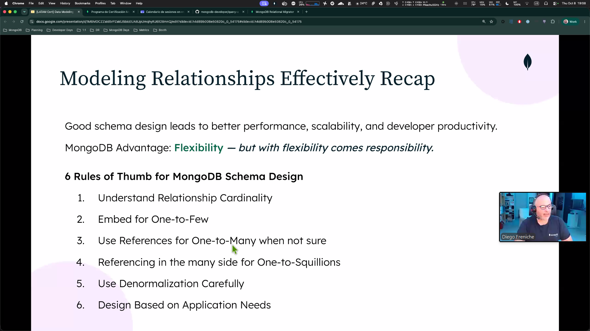

# Migracion de una base relacional a una nosql de mongodb

## core mongo db design concetps

- embedding 
- arrays
- polymorphism

no es una tabla, el documento en realidad es una entidad con todos sus fields. el modelo de documento, aunque se muestra en formato json en realidad se almacena de forma diferente en el cluste.

### patron de atributos.
 caso de uso de ecommerce. 

### validacion de schema
 no solo validar en el backend. sino validar desde tu Base de datos. te permite validar el tipo de campo. define reglas y constraints in an RDBMS.

- schema flexible

## referencing as a means of normalizing

en relacional la unica manera de conectar entidades, debes utilizar ID, unicos entre clases para formar la relacion 1 a mucho.

en mongo puedes realizar lo mismo, utilizar Id de otras colecciones para crear conexiones. tienes arrays y tienes objetos. 

## Data modeling methodogy

1. entities 
2. Workloads
3. relationships
4. patterns

> buscar este flujo mas tarde

no es lo mismo para 10,000 libros a 100 M de libros. miles de millones no son igual. siempres debemos de buscar las entitades y describir sus propiedades.

debemos cuantificar las operaciones y definiras cuanto sera la carga de trabajo. 

definiremos las relaciones, en base a las cargas de trabajo.

al final buscaremos obtimizar estos patrones. 

## Functional Requirements

sentarte con el cliente, preguntar que es lo que quieres. preguntar a tu cliente, especificamente y sentarse a que el defina las necesidades. 

Definir Database Entities

en el caso de embedded documentos es largo y rara vez se accede, entonces entrariamos en un anti patron, pues lo que buscar embebir seria acceder al documento y a toda la informacion que siempre se necesita en conjunto, 

solucion, crear un "detalles documentos" en la misma collecion, en el conjunto de documentos podemos tener el documento "book" y ademas el documento "detalle books" y tener su id y book_id correspondiente, asi buscamos "buscame toda la informacion del documento id y ademas el book id = " 

en mongodb se pueden indexar los array  se pueden embeber los docuento 
> recuerda solo incrustar la informacion clave, pues en caso de actualizacion el documento principal deberas actualizar todos los documentos donde se encuentren incrustada esa informacion, un numero enorme

la solucion para 1 a muchos one-to-many

**Haces la referencia en el lado de muchos** 

## Schema Validation

- optional in mongodb

1. reglas
puedes correr una validacion en formato javascript.  donde para crear una collecion podemos validar que el precio de un articulo debe ser menor a el precio con descuento. 
- se puede crear una validacion para inserccion de documentos. donde puedes aplicar el tipo del field.

2. levels

**nivle strict**: aplicar la regla en todos los documentos. si o si 

**nivel moderate:** 

se puede validar los campos que son obligatorios y definir los nombres del field, las propiedades que tipos deben de ser y ademas estipular un rango para los fields. 

puedes tener mas de una regla a la vez por el polymorphism. 